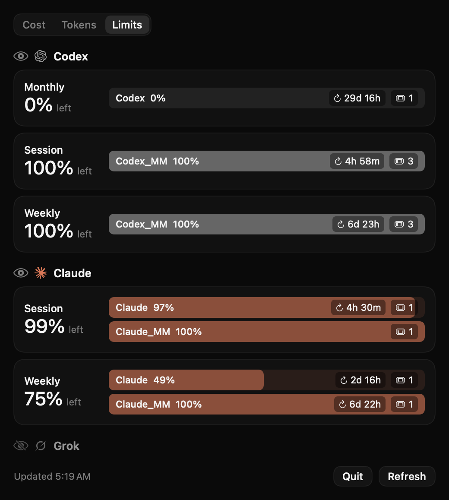
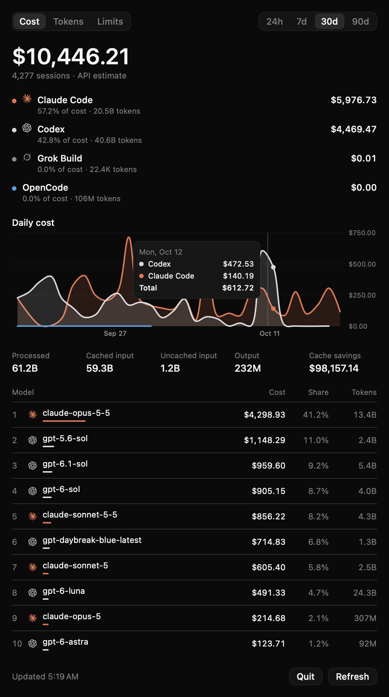
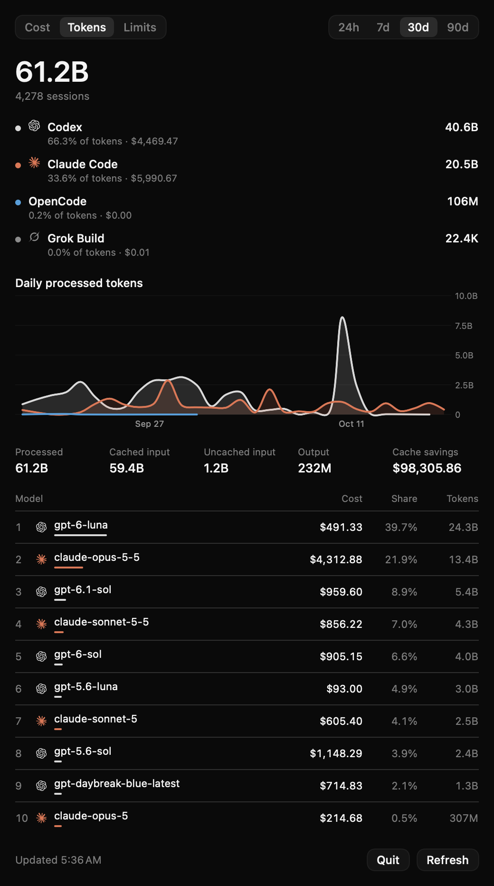

# T3code Bar

A tiny macOS menubar app for [T3 Code](https://github.com/pingdotgg/t3code) users. It shows how much of each coding agent's usage limit you have left, right in the menubar, plus T3's cost and token usage, across all your machines.


| Limits | Cost (with hover) | Tokens |
|---|---|---|
|  |  |  |

## Features

- **Menubar:** provider logo + remaining weekly limit (falls back to monthly) for Codex, Claude and Grok.
- **Limits tab:** session / weekly / monthly windows per account, reset countdowns and reset credits.
- **Cost & Tokens tabs:** totals, per-provider share, daily chart with hover, cache stats and a top-models breakdown for the past 24h / 7 / 30 / 90 days.
- **Multiple devices:** combines data from T3 Code servers on this Mac and on remote machines (over SSH).
- **Per-agent visibility:** click the eye next to an agent to hide it from the menubar.
- Uses T3 Code's dark theme and brand icons. Refreshes limits every 60s.

## How it works

T3code Bar keeps no data of its own. It connects to your running T3 Code server(s) with a **read-only** session token and calls the same WebSocket RPCs the T3 app uses (`subscribeServerConfig` for limits, `server.getUsageSummary` for usage). For remote machines it opens an `ssh -N -L` port-forward, which is closed when the app quits. Nothing is sent anywhere else.

## Requirements

- macOS 14+ and the Swift toolchain (Xcode or Command Line Tools)
- T3 Code running locally (desktop app or `t3 serve`), plus any remote machines you want to include

## Install

```sh
git clone https://github.com/brahimhamichan/t3code-bar
cd t3code-bar
./build.sh                # builds "T3code Bar.app"
open "T3code Bar.app"
```

To launch at login, add the app under System Settings → General → Login Items.

## Configure

All config lives in `~/.config/t3code-bar/`.

**1. Token per device** (read-only scopes). On each machine running T3 Code:

```sh
t3 auth session issue --scope orchestration:read --scope diagnostics:read \
  --ttl 3650d --label t3code-bar --token-only
```

Save the output on your Mac as `~/.config/t3code-bar/<id>.token` (`chmod 600`). This Mac's id is `local`.

**2. Devices (optional).** Without `devices.json` only this Mac is used. To add remote machines (reachable with key-based `ssh <host>`):

```json
[
  { "id": "local", "name": "This Mac" },
  { "id": "devbox", "name": "devbox", "ssh": "devbox" }
]
```

## Development

Everything is in `App.swift` (SwiftUI + Swift Charts), built by `build.sh` without an Xcode project.

`"T3code Bar.app/Contents/MacOS/T3codeBar" --snapshot <dir> [Cost|Tokens|Limits] [yyyy-MM-dd]` renders the popover and menubar item to PNGs. The optional date simulates a chart hover.

## License

[MIT](LICENSE). See [NOTICE](NOTICE.md) for icon attributions and trademarks. Not affiliated with T3 Tools Inc.

## Stream Deck plugin

`streamdeck/plugin` adds an **Agent Limit** key that shows weekly limit left for all agents, one agent, or one account (pick it in the key's settings). Press a key to open T3 Code. It reads `~/.config/t3code-bar/limits.json`, which the menubar app writes on every refresh, so the app must be running.

```sh
cd streamdeck/plugin && npm install
cp -R . ~/Library/Application\ Support/com.elgato.StreamDeck/Plugins/io.github.brahimhamichan.t3codebar.sdPlugin
# then restart Stream Deck
```
